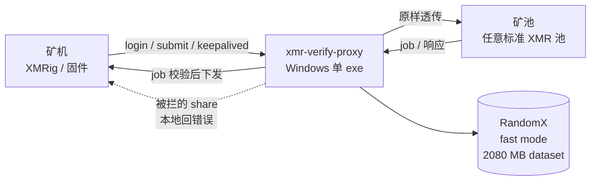

# xmr-verify-proxy

一个**只做校验和转发**的 Monero（XMR）Stratum 中间件，为 Windows 编写，单个 exe，无运行时依赖。

矿机连它，它连矿池。每一份 share 在转发前都会被本地用 RandomX（fast mode，2080 MB dataset）重新算一遍哈希，
只有真正合格、真正对应下发的 job 的 share 才会到达矿池。不合格的直接在本地拦下并回一个错误，**矿池永远看不到**。

存在的理由很具体：有些矿机固件对个别 job 处理有误，会持续提交无效 share，最终被矿池拉黑。
这层中间件让这类 share 死在本地，矿池那边只看到干净的提交记录。

## 它不是什么

之前那份 `ltc-stratum-proxy` 是**聚合型**代理：单条上游连接、多矿机共享 blob、tag 分配 nonce 槽位、
难度重映射（`minerDifficulty` / `poolForwardRatio`）、信任抽样校验、30 天历史面板。那套东西依赖你自己矿池的
`proxySlots` 多 blob 下发，和这里的需求是两件事。

这里是 **1:1 透明转发**：一条矿机连接对应一条上游连接。`job_id`、`session id`、`nonce`、`result` 全部原样透传，
代理不改写任何协议字段。除了下面列出的拦截，线上字节就是矿机发来的字节。

## 工作方式



两个方向各有一道关卡：

**上游 → 矿机（job 校验）**：job 结构不合法就不下发。检查项是 `blob` 必须 76 字节、`seed_hash` 必须 32 字节、
`target` 不能为零、`algo` 必须是 `rx/0`、`job_id` 和 `height` 必须存在。这些正是会让矿机算错东西的输入，
不下发就不会产生坏 share。如果矿池在 login 响应里就塞了一个坏 job，整个 login 响应都不下发，并断开矿机连接让它重连。

**矿机 → 上游（share 校验）**，按代价从低到高依次卡：

| 顺序 | 检查 | 不通过时的回执 | 说明 |
|---|---|---|---|
| 1 | session id 是否为矿池下发的那个 | `Unauthenticated` | 登录未完成或会话错乱 |
| 2 | `job_id` / `nonce` / `result` 格式 | `Invalid submit params` | nonce 8 位 hex、result 64 位 hex |
| 3 | `job_id` 是否是我们真正下发过的 | `Invalid job id` | 过期/未知 job，不冒险转发 |
| 4 | 同一 job 的 nonce 是否重复 | `Duplicate share` | 每个连接独立去重 |
| 5 | 哈希尾部 u64 是否满足 job target | `Low difficulty share` | 一次比较，无需算哈希 |
| 6 | RandomX 重算是否逐字节等于 result | `Invalid result` | 真正的校验，约 3 ms |

任何一项不通过：不转发，本地回错误，计入统计。矿机侧看到的是一次普通 reject，继续挖矿即可。

## 快速开始

### 编译

需要 VS 2022 Build Tools（C++ 工作负载，含 `ml64.exe`）和 CMake：

```powershell
python -m pip install cmake
powershell -ExecutionPolicy Bypass -File .\build.ps1
```

产物在 `dist\xmr-verify-proxy.exe`（静态 CRT，拷到别的机器直接能跑）。

### 运行

```powershell
copy config.example.json config.json
notepad config.json          # 改 upstream 和 listen
.\dist\xmr-verify-proxy.exe run --config config.json
```

或者不写配置文件，命令行直接给：

```powershell
.\dist\xmr-verify-proxy.exe run --upstream xmr.kryptex.network:7029 --listen 0.0.0.0:3333
```

然后把矿机指向 `你的IP:3333`，worker/pass 保持原样（代理不改写 login）。

状态页默认在 `http://127.0.0.1:3356/`，每 2 秒刷新；JSON 在 `/api/stats`。

## 校验能力实测

本机：AMD Ryzen 7 8845H（8 核 16 线程）+ 31 GB 内存，Windows，官方 RandomX v1.2.1，MSVC 编译，未开大页。

### 单次校验耗时（这个才是中间件的关键指标）

| 模式 | 单线程算力 | 单次哈希 mean | p50 | p95 |
|---|---|---|---|---|
| **fast（FULL_MEM）** | **~300 H/s** | **3.3–3.6 ms** | 3.25–3.60 ms | 4.1–4.3 ms |
| light（仅 cache） | ~45 H/s | 22.2–22.5 ms | 22.1 ms | 23.8 ms |

fast 比 light 快 **约 6.5 倍**。light 模式的 22 ms 其实也够用（一份 share 的间隔通常是几十秒），
fast 模式的价值在于把校验彻底从关键路径上抹掉。

### 吞吐（多线程，fast mode）

| 线程数 | 算力 | 单次哈希 |
|---|---|---|
| 1 | 276–330 H/s | 3.3–3.6 ms |
| 4 | 1166–1345 H/s | 3.4 ms |
| 8 | 1736–1879 H/s | 4.4–4.6 ms |

8 线程没有线性扩展，是这台笔记本的功耗/内存带宽上限（非代理自身瓶颈），也可以对照看：
XMRig 在同机同 seed 下的相对关系与之一致。

### 内存与初始化

| 项目 | 数值 |
|---|---|
| dataset（fast mode） | 2080 MiB |
| cache（每个 seed） | 256 MiB |
| dataset 初始化 | 4.5–4.7 s（8 线程） |
| 常驻总占用 | 约 2.3 GiB；开启 `prebuildNextSeed` 预热下一个 seed 时峰值约 4.6 GiB |

换算一下就能对外讲：**一份 share 消耗 3.3 ms，而矿机平均几十秒才产生一份**，即校验占用单核约万分之一。
即使 8 线程满负荷，这台机器也能每秒校验 1700+ 份 share。

### 端到端实测（真实矿池，非仿真）

用内置测试矿工向 `xmr.kryptex.network:7029` 挖到真 share 并经代理转发：

| 场景 | 结果 |
|---|---|
| 伪造 result（声称高难度、哈希对不上） | 本地拦截 `Invalid result` |
| 真实哈希但难度不足（diff 1 < 400015） | 本地拦截 `Low difficulty share` |
| 未知/过期 job_id | 本地拦截 `Invalid job id` |
| 挖到的真 share（diff 203319） | 转发 → **矿池接受 `OK`** |
| 同一份 share 重复提交 | 本地拦截 `Duplicate share` |
| 代理侧校验耗时 | 3.48 ms（矿池往返 250–310 ms） |

job 侧同样用本地假矿池验证过：blob 长度错、缺 `seed_hash`、`algo` 不是 `rx/0`、`target` 为零，
四种坏 job 全部被拦下不下发，随后到达的正常 job 正常下发。

## 配置项

| 键 | 默认 | 说明 |
|---|---|---|
| `listen` | `0.0.0.0:3333` | 矿机接入地址 |
| `upstream` | `xmr.kryptex.network:7029` | 上游矿池（明文端口） |
| `connectTimeoutMs` | 15000 | 上游连接超时 |
| `randomx.fastMode` | `true` | `false` 则退化为 light mode（省 2 GB 内存，慢 6.5 倍） |
| `randomx.prebuildNextSeed` | `true` | 用 `next_seed_hash` 提前建好下一个 seed 的 dataset，切换时不掉速 |
| `randomx.hugePages` | `false` | 大页需要 `SeLockMemoryPrivilege`（管理员），失败自动回退 |
| `randomx.datasetInitThreads` | 0 | 0 = 物理核数的一半 |
| `randomx.vmPool` | 4 | 每个 seed 可并发的校验 VM 数 |
| `randomx.maxCachedSeeds` | 3 | 保留多少个 seed 的 cache |
| `verify.checkHash` | `true` | RandomX 重算校验 |
| `verify.checkTarget` | `true` | 难度校验 |
| `verify.checkDuplicate` | `true` | 同 job 同 nonce 去重 |
| `verify.checkJobId` | `true` | 只接受自己下发过的 job_id |
| `verify.blockInvalidJobs` | `true` | 结构不合法的 job 不下发 |
| `verify.allowedAlgos` | `["rx/0"]` | 只校验得动的算法，其它算法 job 会丢弃 |
| `verify.timeoutMs` | 20000 | 等 cache/dataset 就绪的上限；超时按“无法校验”拦截（fail-closed） |
| `keepaliveSec` | 60 | 空闲这么久就代矿机发 `keepalived`，0 = 关闭 |
| `maxJobsPerSession` | 64 | 每条连接保留的 job 数 |
| `jobMaxAgeSec` | 1800 | job 过期时间 |
| `stats.enabled` / `stats.listen` | `true` / `127.0.0.1:3356` | 状态页 |
| `log.level` / `log.file` | `info` / `logs/proxy.log` | 日志 |

### 关于 fail-closed

如果 RandomX 引擎还没准备好（seed 刚切换、dataset 正在重建）导致无法校验，默认**拦截并回
`Verification unavailable`**，而不是放行。理由：放行一份可能是坏的 share 违背了这套中间件的全部意义；
而拦截只会让矿机多一次 reject。等待上限由 `verify.timeoutMs` 控制。

## 子命令

| 命令 | 用途 |
|---|---|
| `run` | 正常启动代理 |
| `selftest` | 用 `tests/data/submit-vectors.json` 里 9 组真实被接受的 share 自检 RandomX 实现（应 9/9 PASS） |
| `bench --seed <64 hex>` | 测算力和单次哈希延迟，支持 `--threads`、`--light`、`--hugepages` |
| `mine --target ... --login ...` | 内置测试矿工，可挖真 share，也可用 `--fault` 造假 share 验证拦截 |
| `mockpool` | 本地假矿池，可下发结构非法的 job，验证 job 侧拦截 |

自检：

```powershell
.\dist\xmr-verify-proxy.exe selftest --vectors tests\data\submit-vectors.json
# == result: 9 passed, 0 failed ==
```

测试矿工的故障注入（`--fault all` 会依次跑全部场景）：

```powershell
.\dist\xmr-verify-proxy.exe mine --target 127.0.0.1:3333 --login "4...你的地址/kcap" --fault all --threads 8
```

job 侧拦截（本地假矿池 + 代理）：

```powershell
.\dist\xmr-verify-proxy.exe mockpool --mock-listen 127.0.0.1:17029 --mode all
.\dist\xmr-verify-proxy.exe run --upstream 127.0.0.1:17029 --listen 127.0.0.1:3333
python scripts\trace_client.py --target 127.0.0.1:3333 --login "4.../w1" --seconds 12
```

## 测试

```powershell
powershell -ExecutionPolicy Bypass -File .\tests\run-tests.ps1
# ALL 14 CHECKS PASSED
```

全部离线执行，不需要真矿池，也不产生任何真实提交。三组检查：

1. **RandomX 正确性**：用 `tests/data/submit-vectors.json` 里 9 组被真实矿池接受过的 share，
   逐组重算并要求逐字节相同（这组向量同时覆盖了 fast/light 两条路径）。
2. **job 校验**：内置假矿池下发 4 种结构非法的 job（blob 长度错、缺 `seed_hash`、`algo` 不是 `rx/0`、
   `target` 为零），断言它们一条都没到矿机手上，紧接着的合法 job 正常下发。
3. **share 校验**：内置测试矿工对假矿池（`--easy` 把难度降到 3，秒出 share）依次提交
   假 hash、真哈希但难度不足、未知 job_id、真 share、重复 share，断言前三种和重复被本地拦下、
   真 share 被转发并被接受。

测试脚本自己拉起和关闭所有进程，退出码 0 表示全部通过。

### 已验证 / 未验证

在真实矿池 `xmr.kryptex.network:7029` 上验证过的：

- 4 个矿机并发连接各自独立转发，互不影响
- 挖出真 share 经代理校验（3.48 ms）后被矿池接受 `OK`
- 三类非法 share 全部在本地拦下，矿池侧无记录
- 难度调整（400015 → 200007 → 100001）期间 job 正常跟随

**没有**验证过的：

- 用官方 XMRig 客户端实测。本机 Defender 判定 `xmrig.exe` 为
  `Trojan:Win64/DisguisedXMRigMiner` 并直接删除，无法在本机运行。端到端测试用的是仓库内置的
  测试矿工——它按抓包格式完整实现了 `login`/`submit`/`keepalived`，挖的是真 RandomX share，
  但毕竟不是 XMRig 本身。
- seed 切换（`next_seed_hash` 非空的真实切换场景）。数据集预热逻辑写了，但抓包期间矿池没给过
  `next_seed_hash`，只能用假矿池构造。
- 长时间稳定性（数天连续运行、内存增长）。

## 部署注意

**杀毒软件**：exe 内含 RandomX 代码，Windows Defender 会把它判定成
`Trojan:Win64/HashvaultMiner.A`（典型的矿工启发式误报）。这不是签名问题，任何内嵌 RandomX 的未签名程序都会中。
需要把程序所在目录加进 Defender 排除列表：

```powershell
# 管理员 PowerShell
powershell -ExecutionPolicy Bypass -File .\scripts\allow-defender.ps1
```

撤回：`Remove-MpPreference -ExclusionPath '<项目目录>'`

**内存**：fast mode 常驻约 2.3 GiB；`prebuildNextSeed` 打开时峰值约 4.6 GiB。内存吃紧就把
`fastMode` 或 `prebuildNextSeed` 关掉。

**上游连接**：一条矿机连接对应一条上游连接。矿池侧看到的是多个连接，而不是一个聚合连接。
上游断线时代理会直接断开对应矿机，让矿机自己重连——这样会话状态永远是干净的，不会出现代理以为还在挖、
矿池已经丢弃会话的情况。

## 已知限制

- 只支持 RandomX（`rx/0`）。其它算法在 `allowedAlgos` 之外，其 job 会被丢弃。
- 上游只支持明文 TCP（按需求如此）。`xmr.kryptex.network` 的 8888 是 TLS 端口，本程序不支持。
- seed 切换时代理需要重建 dataset（约 5 s）。`prebuildNextSeed` 会在 `next_seed_hash` 出现时就提前建好，
  所以正常情况下不会出现这段空窗；空窗期内的 share 按 fail-closed 拦截。
- Windows 专属（Winsock + MASM 汇编的 RandomX JIT）。

## 目录结构

```text
CMakeLists.txt
build.ps1                 一键编译，产物进 dist/
config.example.json       配置样例
config.json               实际使用的配置
src/
  main.cpp                子命令分发、run/selftest/bench 入口
  proxy.cpp/.h            监听、每矿机会话、job 表、share 校验与转发
  randomx_engine.cpp/.h   dataset/cache 生命周期、seed 预热、VM 池、bench
  net.cpp/.h              Winsock 封装、按行读取
  config.cpp/.h           配置加载
  stats.cpp/.h            计数器与状态页（HTTP）
  log.cpp/.h              日志
  util.cpp/.h             hex、target64/难度换算
  testminer.cpp/.h        内置测试矿工（含故障注入）
  mockpool.cpp/.h         本地假矿池（下发非法 job）
third_party/
  randomx/                官方 RandomX v1.2.1
  nlohmann/json.hpp
tests/
  run-tests.ps1           自动化回归测试（离线，14 项检查）
  data/submit-vectors.json  9 组真实被矿池接受的 share，用作回归测试
scripts/
  allow-defender.ps1      Defender 排除
  genaddr.py              生成格式合法的临时 XMR 地址
  trace_client.py         打印代理/矿池发回的每一行
```

## 协议参考

`nonce` 固定在 blob 偏移 39 处，占 4 字节；`target64 = 0xFFFFFFFFFFFFFFFF / (0xFFFFFFFF / t)`，
`t` 是 4 字节小端 target；share 合格条件是 `result[24:32]` 按小端读成 u64 ≤ `target64`。
RandomX 输入是 `blob[0:39] + nonce + blob[43:76]`，key 是 `seed_hash`。
